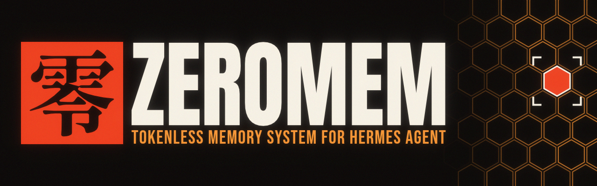
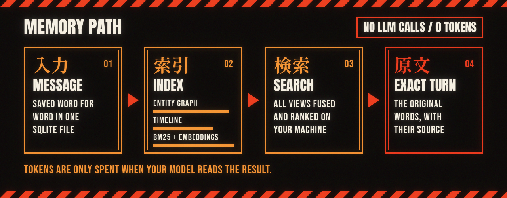
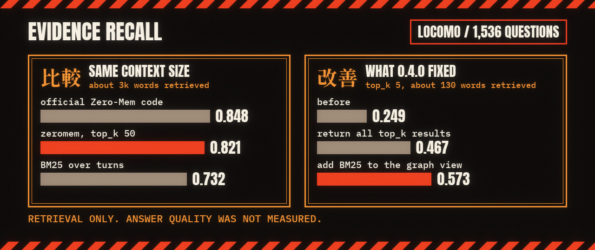

<p align="center"></p>

Memory for [Hermes Agent](https://github.com/NousResearch/hermes-agent). Every message stays word for word in one SQLite file on your machine. Storing and searching cost zero tokens, and your model only pays to read what comes back.

zeromem is a Rust implementation of Zero-Mem by Xiao et al. ([paper](https://arxiv.org/abs/2607.29377), [official code](https://github.com/Zero-Mem/Zero-mem)).

## Install

zeromem is in the [Hermes plugin catalog](https://hermes-agent.nousresearch.com/marketplace/zeromem):

```
hermes plugins install zeromem
```

Then in `~/.hermes/config.yaml`:

```yaml
memory:
  provider: zeromem
```

The first run downloads a 130MB embedding model into `~/.hermes/memory/zeromem-models`.

Switching from another memory provider? Hermes keeps your conversations in its own session history, so you can bring them all in. It costs no tokens, and running it twice won't duplicate anything:

```
hermes zeromem import        # preview
hermes zeromem import --yes
```

The provider syncs turns in the background, prefetches evidence before each turn, and gives your agent `zeromem_recall`, `zeromem_stats` and `zeromem_forget_session`. Recall skips the active session since it's already in context, so "last session" means the one before it.

For Spanish or other non-English conversations, set `{"model": "multilingual-e5-small"}` in `~/.hermes/memory/zeromem.json`.

## How it works



Each turn gets indexed three ways: an entity graph, a timeline of turns, windows and episodes, and BM25 plus dense embeddings. A query gets a deterministic profile, routes to a primary view, runs both retrievals, fuses the scores and pulls in linked turns. No step calls an LLM.

Turns are the source of record. The graph, timeline and BM25 rebuild from them on open, so the indexes can't drift from the data.

<details>
<summary>Paper to code map and deviations</summary>

| paper | module |
|---|---|
| eq 3-4 entity-context graph | `graph.rs`, `ner.rs` |
| eq 5 trace hierarchy | `hierarchy.rs` |
| eq 6 query profile | `profile.rs` |
| eq 7 routing | `route.rs` |
| eq 8-10 graph view (PPR) | `graph_view.rs` |
| eq 11 hierarchical view | `hier_view.rs` |
| eq 12-13 fusion | `fuse.rs` |
| eq 14 evidence closure | `closure.rs` |
| eq 15-16 calibration | `calibrate.rs` |

Defaults follow the paper: gamma 0.6, rho 0.6, top-5 evidence.

Deviations from the paper: spaCy NER is replaced with a heuristic extractor behind a trait, BGE-M3 with bge-small-en-v1.5 through [fastembed](https://github.com/Anush008/fastembed-rs) (a deterministic hash embedder is the offline fallback and what tests use). Both are swappable. multilingual-e5-small is the other built-in dense model, for non-English conversations. Only the dense view changes with it: BM25 stopwords, relative time words, and entity extraction are still English-oriented.

</details>

## Benchmarks



LoCoMo evidence recall: how many of the gold evidence turns come back, over 1,536 questions (categories 1 to 4), with one store per conversation.

| system | words retrieved | recall |
|---|---|---|
| official Zero-Mem | about 2,750 | 0.848 |
| zeromem, `top_k` 50 | about 3,000 | 0.821 |
| BM25 over turns | about 3,000 | 0.732 |
| zeromem, `top_k` 5 (default) | about 130 | 0.573 |

The official code retrieves whole sessions and zeromem retrieves turns, so matched context is the fair comparison. zeromem leads on temporal questions (0.88 vs 0.84) and multi-hop (0.61 vs 0.60). The official code leads on single-hop and open-domain.

What this doesn't show:

- Answer quality. This measures retrieval only.
- Other memory systems. They haven't been benchmarked.
- A clean-room result. Adding BM25 to the graph view came from reading the official code, and matched-context recall was 0.794 before it.
- Speed. The two use different models: BGE-M3 and spaCy against bge-small and heuristic NER.

<details>
<summary>Recall by embedder</summary>

| embedder | `top_k` 5 | `top_k` 50 |
|---|---|---|
| bge-small-en-v1.5 (default) | 0.573 | 0.821 |
| multilingual-e5-small | 0.549 | 0.807 |
| hash fallback | 0.553 | 0.807 |

</details>

## Other ways to use it

**Python**

```
uv add zeromem
```

```python
import zeromem
m = zeromem.ZeroMem("mem.db")
m.ingest_turn("s1", "user", "I moved to Jersey City on February 14, 2022.", 1644796800)
m.query("When did I move?")
```

**CLI**

```
zm --db mem.db ingest turns.jsonl     # {"session_id","speaker","text","ts"}
zm --db mem.db query "When did I move?"
zm --db mem.db stats
```

**Claude Code**

One shared store across every project, in `~/.zeromem` (override with `ZEROMEM_HOME`).

```
cargo install --git https://github.com/ptaranat/zeromem zeromem
claude plugin marketplace add ptaranat/zeromem
claude plugin install zeromem@zeromem
```

<details>
<summary>Manual setup and caveats</summary>

Add `zm hook` to `Stop` and `SessionEnd` in `~/.claude/settings.json`, then run `claude mcp add --scope user zeromem -- zm mcp`. Verify with `just ccsmoke`.

Claude Code gives MCP servers no session identity, so recall can echo turns from the current session. Forgetting a session that's still open in another window partly brings it back as that session keeps talking. There's no prompt-time prefetch, so recall is tool-driven.

</details>

## Build

```
just test        # offline, hash embedder
just demo        # ingest examples/dungeon-books.jsonl, run queries
just dev         # maturin develop into .venv
cargo build --release
```

The `fastembed` feature (default) pulls onnxruntime and downloads bge-small-en-v1.5 on first use. `--no-default-features` drops both. Opening a store with a different model re-embeds every turn, so switching needs no migration.

## Credits

Method from the [Zero-Mem paper](https://arxiv.org/abs/2607.29377) and [official code](https://github.com/Zero-Mem/Zero-mem) by Yilin Xiao, Zhehan Zhu, Yujing Zhang, Jin Chen, Zijin Hong, Luyao Zhuang, Qinggang Zhang, Shengyuan Chen, Xiaocao Ouyang, Lingfei Ren, and Xiao Huang. zeromem started as a clean-room implementation from the paper text, before the authors released their code. The 0.4.0 retrieval fixes came from benchmarking against that code once it was out, so later versions aren't clean-room. Integration shape follows [mnemosyne](https://github.com/mnemosyne-oss/mnemosyne).

MIT licensed.
